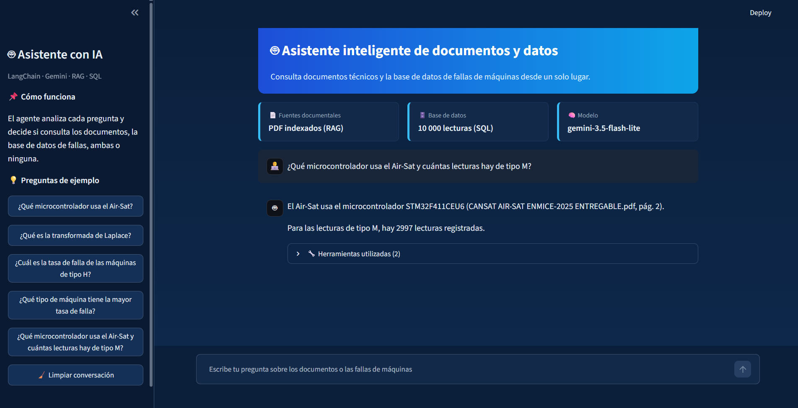
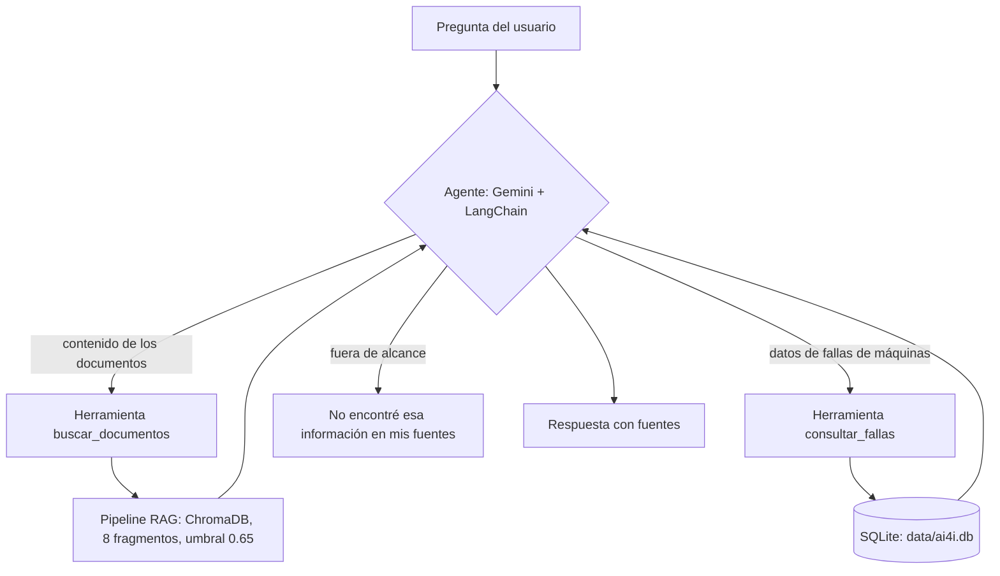
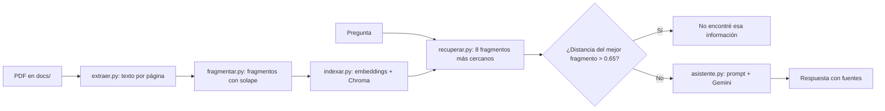

# Asistente con agente de IA: documentos (RAG) y datos (SQL)

Proyecto de IA generativa en dos capas:

1. **Asistente RAG** que lee tus propios PDF y responde **solo con la información que está en ellos**, citando el archivo y la página de cada dato.
2. **Agente con LangChain** que decide por sí mismo si debe consultar los documentos (RAG), una base de datos de fallas de máquinas (SQL), ambas o ninguna, y que responde "no sé" en lugar de inventar.



**RAG** (Retrieval-Augmented Generation, generación aumentada por recuperación): primero se buscan los fragmentos más parecidos a la pregunta y después un modelo de lenguaje (Gemini) redacta la respuesta usando únicamente esos fragmentos.

## Contenido

- [Cómo funciona](#cómo-funciona)
- [Capa 1: pipeline RAG](#capa-1-pipeline-rag)
- [Capa 2: agente con herramientas](#capa-2-agente-con-herramientas)
- [Requisitos](#requisitos)
- [Cómo ejecutarlo (Windows)](#cómo-ejecutarlo-windows)
- [Elegir el modelo](#elegir-el-modelo)
- [Evaluación](#evaluación)
- [Estructura del proyecto](#estructura-del-proyecto)
- [Problemas frecuentes](#problemas-frecuentes)
- [Tecnologías](#tecnologías)
- [Limitaciones y mejoras](#limitaciones-y-mejoras)

## Cómo funciona



1. El usuario hace una pregunta.
2. El agente lee la descripción de sus dos herramientas y elige cuál usar (una, varias o ninguna).
3. La herramienta devuelve los datos y el agente redacta la respuesta final, citando la fuente.

## Capa 1: pipeline RAG



| Paso | Archivo | Qué hace |
|---|---|---|
| 1. Extraer | `src/extraer.py` | Lee cada PDF con `pypdf`, limpia espacios y guarda texto, archivo y página. |
| 2. Fragmentar | `src/fragmentar.py` | Divide cada página en fragmentos de ~900 caracteres con solape de 120, para no cortar ideas. |
| 3. Indexar | `src/indexar.py` | Convierte cada fragmento en un vector (embedding) y lo guarda en una base vectorial Chroma. |
| 4. Recuperar | `src/recuperar.py` | Busca los 8 fragmentos más cercanos en significado a la pregunta. |
| 5. Generar | `src/asistente.py` | Aplica el umbral, arma el prompt con los fragmentos y llama al modelo, con reintentos. |
| 6. Interfaz RAG | `src/app.py` | Página web local con Streamlit: caja de pregunta, respuesta y fragmentos usados. |
| 7. Evaluar | `src/evaluar.py` | Corre 10 preguntas de prueba y genera `evaluacion.xlsx` para revisarlas. |

**Decisiones de diseño**
- **Embeddings multilingües** (`paraphrase-multilingual-MiniLM-L12-v2`): funcionan bien con documentos en español y se ejecutan en tu computador, sin clave de API. Se encargan de *buscar*; Gemini se encarga de *responder*.
- **Umbral de 0.65:** si el mejor fragmento está más lejos que eso, la pregunta se considera fuera de los documentos y no se llama al modelo. Se eligió porque en las pruebas las preguntas válidas quedaron entre 0.35 y 0.55, y las preguntas ajenas (por ejemplo, la capital de Francia) pasaron de 0.73.
- **Prompt estricto:** el modelo debe responder solo con el contexto, decir "No encontré..." si falta información, responder en español y citar `(archivo, pág. N)`.
- **Reintentos y tiempo límite:** el nivel gratuito de Gemini se satura a veces (error 503). Cada llamada tiene un límite de 30 segundos y hasta 3 intentos.

## Capa 2: agente con herramientas

El agente (`src/agente.py`) se construye con `create_agent` de LangChain 1.x y Gemini como modelo. Cada herramienta se registra con el decorador `@tool`, y su **descripción (docstring)** es lo que el modelo lee para decidir cuándo usarla.

| Herramienta | Fuente | Para qué sirve |
|---|---|---|
| `buscar_documentos` | PDF indexados en ChromaDB (reutiliza `recuperar.py` y el mismo umbral de 0.65) | Preguntas sobre el contenido de los documentos |
| `consultar_fallas` | SQLite `data/ai4i.db` (dataset AI4I 2020, 10 000 lecturas) | Lecturas, fallas y tasa de falla por tipo de máquina (L, M, H) |

La base `ai4i.db` proviene del proyecto de mantenimiento predictivo: [mantenimiento-predictivo-sensores](https://github.com/Castel8/mantenimiento-predictivo-sensores).

**Límites y seguridad**
- **Máximo de pasos** (`MAX_PASOS = 12`): evita que el agente entre en bucles. Si se supera, responde con un mensaje de límite.
- **Manejo de errores** en ambas herramientas: tipo inválido, base de datos ausente y fallos de consulta devuelven un mensaje claro en lugar de romper el programa.
- **Reintentos** (hasta 3, con espera creciente) si la API falla, por ejemplo por cuota.
- **Respuesta "no sé":** si ninguna herramienta tiene la información, responde *"No encontré esa información en mis fuentes."* y no inventa datos.
- **Consultas SQL parametrizadas** (sin inyección) y validación del tipo (solo L, M o H).

**Ejemplo de trazas**
```
PREGUNTA: ¿Qué microcontrolador usa el Air-Sat y cuántas lecturas hay de tipo M?
  -> Llama a buscar_documentos con {'pregunta': 'microcontrolador Air-Sat'}
  -> Llama a consultar_fallas con {'tipo': 'M'}
RESPUESTA: El microcontrolador es el STM32F411CEU6 (ARM Cortex-M4, 100 MHz).
Para el tipo M hay 2997 lecturas, con 83 fallas y una tasa de falla del 2.77 %.

PREGUNTA: ¿Qué tipo de máquina (L, M o H) tiene la mayor tasa de falla?
  -> Llama a consultar_fallas con {'tipo': 'L'}
  -> Llama a consultar_fallas con {'tipo': 'M'}
  -> Llama a consultar_fallas con {'tipo': 'H'}
RESPUESTA: El tipo L, con una tasa de falla de 3.92 % (235 fallas en 6000 lecturas).

PREGUNTA: ¿Cuál es la capital de Francia?
RESPUESTA: No encontré esa información en mis fuentes.
```

**Interfaz** (`src/app_agente.py`): chat en Streamlit con tema azul marino, preguntas de ejemplo en la barra lateral, botón para limpiar la conversación y, bajo cada respuesta, un desplegable con las herramientas que el agente utilizó y lo que devolvieron.

## Requisitos

- Python 3.11
- Anaconda o `venv` para el entorno virtual
- Una clave de API de Gemini (el nivel gratuito de Google AI Studio alcanza para probarlo)
- Conexión a internet (la primera ejecución descarga el modelo de embeddings, de unos 470 MB)

## Cómo ejecutarlo (Windows)

**1. Clonar el repositorio y entrar a la carpeta**
```
git clone https://github.com/Castel8/rag-agente-langchain.git
cd rag-agente-langchain
```

**2. Crear el entorno e instalar dependencias**
```
conda create -n rag-asistente python=3.11
conda activate rag-asistente
pip install -r requirements.txt
```

**3. Conseguir la clave de API**
1. Entra a [aistudio.google.com](https://aistudio.google.com) con tu cuenta de Google.
2. Crea un proyecto (si no tienes uno) y luego una clave en **API Keys**.
3. Copia `.env.example` como `.env` en la raíz del proyecto y escribe tu clave, sin espacios ni comillas:
```
GEMINI_API_KEY=tu-clave-aquí
```
El archivo `.env` está en `.gitignore`: **nunca lo subas a GitHub**. Si tu clave se expone, bórrala en AI Studio y crea otra.

**4. Poner tus PDF**

Copia tus archivos `.pdf` dentro de la carpeta `docs/`. Deben tener texto seleccionable (no ser imágenes escaneadas).

**5. Indexar los documentos** (solo la primera vez o cuando cambies los PDF)
```
python src\indexar.py
```
Debe decir `Fragmentos indexados: N`. La carpeta `chroma_db/` se genera sola y no se sube al repositorio.

**6. Abrir la interfaz del agente**
```
streamlit run src\app_agente.py
```
Se abre el navegador en `http://localhost:8501`. Si pide un correo, déjalo en blanco y pulsa Enter. Ejecuta el comando siempre desde la raíz del proyecto, para que se aplique el tema de `.streamlit/config.toml`.

**Otras formas de usarlo**

| Comando | Qué hace |
|---|---|
| `python src\agente.py` | Ejecuta en consola 6 preguntas de prueba mostrando las trazas |
| `python src\probar_limites.py` | Prueba los límites: tipo inválido, base ausente, máximo de pasos y pregunta sin herramienta |
| `streamlit run src\app.py` | Interfaz del asistente RAG simple (solo documentos), con panel de fragmentos recuperados |
| `python src\asistente.py` | Asistente RAG sin interfaz: edita la lista de preguntas al final del archivo |
| `python src\evaluar.py` | Evaluación del RAG con 10 preguntas, genera `evaluacion.xlsx` |

## Elegir el modelo

El modelo se define en la variable `MODELO` de `src/asistente.py` y de `src/agente.py`. Los nombres de modelos cambian y algunos se saturan en el nivel gratuito. Para ver cuáles responden en tu cuenta, ejecuta:
```
python src\probar_modelos.py
```
y copia en `MODELO` un nombre marcado como `OK` (sin el prefijo `models/`). En las pruebas de este proyecto, Gemini 3.5 Flash Lite fue el más rápido y disponible. Algunos modelos recientes ignoran la temperatura (aparece un aviso inofensivo) y devuelven la respuesta en bloques; el agente ya extrae el texto con la función `texto()`.

## Evaluación

**RAG:** se probó con 10 preguntas sobre 4 PDF propios (proyectos universitarios): datos puntuales, una pregunta que combina dos documentos y dos preguntas **sin respuesta** en los documentos.

| Criterio | Resultado |
|---|---|
| Respuestas correctas | 10 de 10 |
| Fuente correcta (preguntas con respuesta) | 8 de 8 |
| Invenciones | 0 |
| Preguntas sin respuesta en los documentos | Las 2 respondieron "No encontré esa información" |

**Agente:** se probó con 6 preguntas (2 de documentos, 2 de SQL, 1 que requiere ambas y 1 fuera de alcance), revisando las trazas.

| Pregunta | Herramienta elegida | Resultado |
|---|---|---|
| Microcontrolador del Air-Sat | `buscar_documentos` | Correcto, con fuente y página |
| Qué es la transformada de Laplace | `buscar_documentos` | Correcto, con fuente y página |
| Tasa de falla del tipo H | `consultar_fallas` | 2.09 % (correcto) |
| Tipo con mayor tasa de falla | `consultar_fallas` ×3 | Tipo L, 3.92 % (correcto) |
| Microcontrolador y lecturas de tipo M | Ambas herramientas | Respondió las dos partes |
| Capital de Francia | Ninguna | "No encontré esa información en mis fuentes." |

Elección correcta de herramienta en **6 de 6** preguntas y sin datos inventados. Las pruebas de límites (`probar_limites.py`) también pasaron: tipo inválido rechazado, base de datos ausente detectada, máximo de pasos respetado y una pregunta que ninguna herramienta puede responder (fallas por modo TWF) no produjo cifras inventadas.

Para repetir la evaluación del RAG con tus documentos, edita la lista `PREGUNTAS` de `src/evaluar.py` (pregunta y respuesta esperada), ejecuta `python src\evaluar.py` y completa en `evaluacion.xlsx` las columnas de sí/no.

## API (FastAPI)

Microservicio que expone el modelo de fallas (Gradient Boosting) y el asistente RAG. Se diseñó con enfoque *API first*: primero los conceptos ([`especificacion/conceptos.md`](especificacion/conceptos.md)), los requisitos ([`especificacion/requisitos.md`](especificacion/requisitos.md)) y el contrato ([`especificacion/contrato.md`](especificacion/contrato.md)), y después el código., después el código.

| Endpoint | Qué hace |
|---|---|
| `GET /health` | Verifica que el servicio está activo |
| `POST /predict` | Recibe las lecturas de una máquina y devuelve la probabilidad de falla y la predicción (umbral 0.5) |
| `POST /ask` | Responde una pregunta sobre los documentos, citando solo las fuentes usadas; si no hay información, `encontrado: false` |

**Ejecutar**
```
uvicorn api.main:app --reload
```
Documentación interactiva (Swagger) en `http://127.0.0.1:8000/docs` y contrato OpenAPI en `/openapi.json`.

**Ejemplo**
```json
POST /predict
{"air_temp_k": 298.9, "process_temp_k": 309.0, "rpm": 1410, "torque_nm": 65.7, "tool_wear_min": 191, "type": "L"}

200 OK
{"probabilidad_falla": 0.9998, "prediccion": 1}
```

**Decisiones de diseño**
- Pydantic valida tipos y rangos; los errores devuelven `{"detalle": "..."}` con código `422` (el estándar de FastAPI para datos inválidos), `503` si el modelo de lenguaje no responde y `504` si se supera el tiempo.
- La API calcula `power_w` y `temp_diff_k` con las mismas fórmulas del entrenamiento; el cliente no las envía.
- Una pregunta sin respuesta en los documentos no es un error: devuelve `200` con `encontrado: false`.
- Los rangos permitidos son más amplios que los datos de entrenamiento (por ejemplo, rpm hasta 5000 frente a un máximo de 2886 en el dataset); fuera de ese rango las predicciones del modelo no son confiables.
- El modelo se guardó con scikit-learn 1.9.0; con otra versión aparece un aviso (`InconsistentVersionWarning`) y conviene instalar la misma.

**Pruebas**
```
python -m pytest -v
```
Cubren `/health`, `/predict` con datos válidos y `/predict` con datos inválidos.

## Estructura del proyecto

```
.
├── .streamlit/
│   └── config.toml       # tema azul marino de la interfaz
├── data/
│   └── ai4i.db           # base SQLite de lecturas de máquinas
├── docs/                 # tus PDF y la captura de la interfaz
├── src/
│   ├── extraer.py
│   ├── fragmentar.py
│   ├── indexar.py
│   ├── recuperar.py
│   ├── asistente.py      # asistente RAG (consola)
│   ├── app.py            # interfaz del asistente RAG
│   ├── agente.py         # agente con las dos herramientas
│   ├── app_agente.py     # interfaz del agente
│   ├── probar_limites.py # pruebas de límites y errores
│   ├── evaluar.py
│   ├── probar_llm.py     # prueba la conexión con el modelo
│   └── probar_modelos.py # lista y prueba los modelos disponibles
├── api/
    ├──main.py
    ├──test/
          ├── test_api.py
    ├──models/
          ├──modelo_gb.joblib
    ├──especificacion
          ├──conceptos.md
          ├──contrato.md
          ├──requisitos.md
├── chroma_db/            # base vectorial (se genera, no se sube)
├── .env                  # tu clave (no se sube)
├── .env.example          # plantilla de la clave
├── .gitignore
├── requirements.txt
└── README.md
```

## Problemas frecuentes

| Síntoma | Causa y solución |
|---|---|
| `503 UNAVAILABLE` o respuestas muy lentas | El modelo está saturado. Reintenta más tarde o cambia `MODELO` (ver "Elegir el modelo"). |
| `404 NOT_FOUND ... no longer available` | El modelo ya no existe para tu cuenta. Elige otro con `probar_modelos.py`. |
| Error de cuota (`429` o similar) al probar el agente | Se superó el límite de peticiones del nivel gratuito. Espera un minuto y repite; el agente hace varias llamadas por pregunta. |
| La clave no se encuentra o da error de autenticación | Revisa que el archivo se llame exactamente `.env` (no `api.env` ni `.env.txt`), esté en la raíz y tenga `GEMINI_API_KEY=...` sin espacios. |
| `ModuleNotFoundError: No module named 'chromadb'` (o `langchain`) | Estás en otro entorno. Activa el correcto con `conda activate rag-asistente` e instala con `pip install -r requirements.txt`. |
| `Base de datos no encontrada` en el agente | Falta `data/ai4i.db`. Verifica que la carpeta `data/` esté en la raíz del proyecto. |
| `DLL load failed ... Control de aplicaciones bloqueó este archivo` | Windows (Smart App Control) bloqueó una librería. Reinstálala con `conda install` en lugar de `pip`, o usa Google Colab. |
| `IndentationError: unexpected indent` | Al copiar código se colaron espacios al inicio de las líneas. Pégalo sin sangría en el margen izquierdo. |
| Streamlit queda congelado en la terminal | Haz clic en la ventana y pulsa Esc; luego Ctrl + C. |
| "No encontré esa información" en una pregunta que sí está en el PDF | Reformula la pregunta, revisa que el PDF tenga texto real y, si es necesario, sube `UMBRAL` en `src/asistente.py` y `src/agente.py`. |

## Tecnologías

Python · LangChain · Google Gemini (`google-genai`, `langchain-google-genai`) · ChromaDB · sentence-transformers · pypdf · SQLite · Streamlit · openpyxl

## Limitaciones y mejoras

- La evaluación es una prueba pequeña y de preguntas sencillas, no un banco de pruebas exhaustivo. El umbral de 0.65 se calibró con estos documentos y conviene revisarlo con otros.
- No lee PDF escaneados (requeriría OCR) ni tablas o figuras dentro de imágenes.
- Los modelos ligeros pueden agregar detalles que no están en el texto, por eso conviene revisar las fuentes citadas.
- La herramienta SQL solo responde por tipo de máquina (L, M, H) y los datos de fallas son sintéticos.
- Cada pregunta es independiente: el agente no recuerda la conversación anterior.
- Nivel gratuito de Gemini: límite de peticiones por minuto y por día.

**Mejoras posibles:** memoria de conversación, más herramientas (por ejemplo, consultas SQL más flexibles con validación estricta), evaluación automática de las respuestas del agente y despliegue en línea.

## Autor

Sebastian Castillo Castillo — ingeniero físico, proyecto de portafolio en datos e IA generativa.
